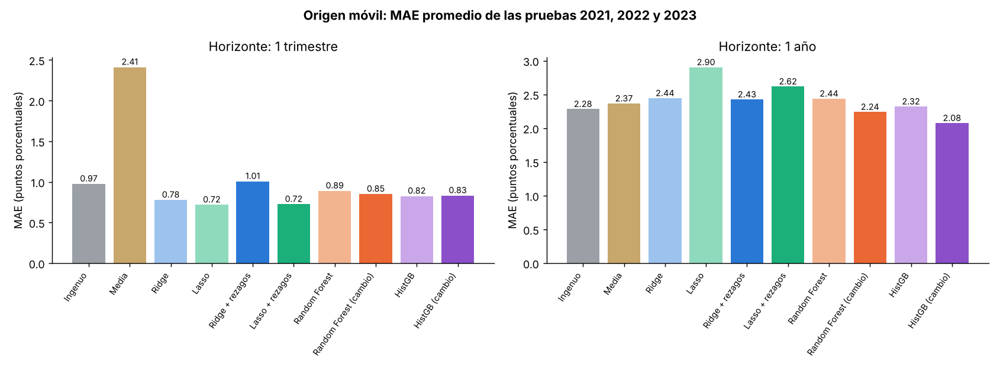
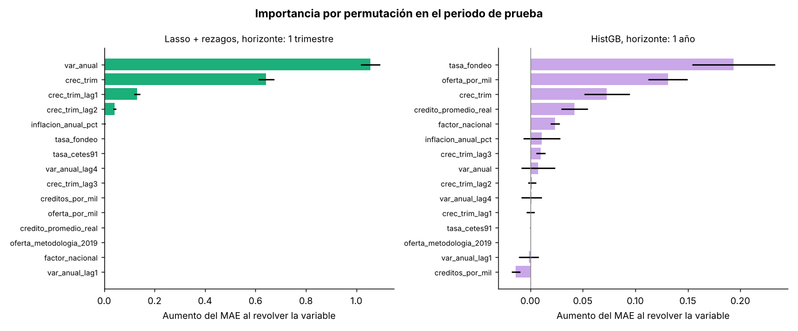

# Resultados del modelado

**El Precio del Ladrillo** · Segunda entrega de modelos (corridas 1 a 4)

---

## En resumen

- **A un trimestre, el mejor modelo es Lasso con rezagos del crecimiento trimestral.** Baja el error del ingenuo de 0.86 a 0.58 puntos (32% menos). Le gana al ingenuo y al Lasso sin rezagos en los cuatro años de prueba y en 30 de los 32 estados.
- **Los árboles no le ganan a Lasso a un trimestre.** Random Forest queda en 0.67 y HistGradientBoosting entre 0.75 y 0.77.
- **Casi todo lo que sabe el modelo viene del propio precio.** La variación de hoy y el crecimiento de los últimos tres trimestres explican el pronóstico. El crédito, la oferta y las tasas aportan casi nada a un trimestre.
- **A un año, ningún modelo le gana claramente a la media.** En la partición principal el mejor (HistGB, 2.37) apenas mejora a la media (2.39). En el origen móvil, HistGB sobre el cambio sale mejor en promedio (2.08 contra 2.37), pero pierde con la media en 2021 y gana en 2022 y 2023. El resultado depende del año de prueba.
- **A un año asoman la tasa de fondeo, la oferta y el crédito promedio**, con pesos chicos.

---

## Qué se predice

La **variación anual del índice SHF** (`var_anual_shf_pct`) de cada estado, en dos horizontes:

- **1 trimestre:** la variación del siguiente trimestre.
- **1 año:** la variación del mismo trimestre del año siguiente.

En los dos casos el modelo solo usa información que ya se conocía en el trimestre actual. No se predice el nivel del índice, porque el índice siempre sube y cualquier modelo lo "adivina" solo con la tendencia.

---

## Variables de entrada

Todas son del trimestre actual:

- **Del precio:**
  - variación anual de hoy (`var_anual`)
  - variación de un trimestre antes y de un año antes (`var_anual_lag1`, `var_anual_lag4`)
  - crecimiento del último trimestre (`crec_trim`)
  - **nuevo:** crecimiento trimestral de uno, dos y tres trimestres antes (`crec_trim_lag1`, `crec_trim_lag2`, `crec_trim_lag3`), calculados del mismo índice SHF con un desplazamiento por estado
  - **factor nacional:** el promedio de la variación de los otros 31 estados, como en Mattera y Franses (2025)
- **Crédito:** créditos por cada mil habitantes y crédito promedio en pesos de 2024.
- **Oferta:** viviendas en oferta por cada mil habitantes y el indicador del cambio de medición de 2019.
- **Tasas e inflación:** tasa de fondeo, tasa de CETES a 91 días e inflación anual.

---

## Modelos

| Modelo | Qué hace | Variables |
|---|---|---|
| Ingenuo | La variación del siguiente periodo es igual a la de hoy | — |
| Media | El promedio de la variación en el entrenamiento | — |
| Ridge, Lasso | Regresión lineal con penalización (primera entrega) | 12 |
| Ridge + rezagos, Lasso + rezagos | Igual, más los tres rezagos de `crec_trim` (corrida 1) | 15 |
| Random Forest | 500 árboles, hoja mínima de 5, la mitad de las variables en cada corte (corrida 2) | 15 |
| HistGB | HistGradientBoosting: 300 iteraciones, tasa de 0.05, profundidad 3 (corrida 2) | 15 |
| ... (cambio) | El árbol aprende el **cambio** `y − var_anual` y al final se le suma `var_anual` de hoy | 15 |

Los dos primeros son la referencia: un modelo solo vale si le gana al ingenuo. Se usó HistGradientBoosting de scikit-learn en lugar de XGBoost para no agregar otra librería; los dos son boosting de árboles.

---

## Validación

- **Partición principal:** entrenamiento con objetivos de 2017 a 2022, prueba con objetivos de 2023 en adelante (hasta 2026T1 a un trimestre y hasta 2026T2 a un año).
  - 1 trimestre: 736 filas de entrenamiento y 416 de prueba.
  - 1 año: 640 filas de entrenamiento y 448 de prueba.
- **Por tiempo, nunca aleatoria.** Dos trimestres seguidos de un mismo estado son casi la misma fila, así que mezclarlos haría que el modelo pareciera mejor de lo que es.
- **Alpha de Ridge y Lasso:** también por tiempo y solo dentro del entrenamiento. Se valida con los tres últimos años del entrenamiento (2020, 2021 y 2022 en la partición principal), entrenando cada vez solo con los años anteriores.
- **Origen móvil (corrida 3):** se entrena con objetivos hasta 2020, hasta 2021 y hasta 2022, y se prueba con el año siguiente (2021, 2022 y 2023). Se reporta el MAE de cada corte y el promedio.

---

## Corridas 1 y 2: partición principal

**MAE y RMSE** están en puntos porcentuales: entre más bajos, mejor. **R2** mide qué tanto del movimiento real explica el modelo; 1 es perfecto y un valor negativo significa que es peor que usar el promedio de la prueba.

### Horizonte: 1 trimestre

| Modelo | MAE | RMSE | R2 |
|---|---|---|---|
| Ingenuo | 0.864 | 1.180 | 0.794 |
| Media | 2.516 | 3.124 | -0.442 |
| Ridge | 0.757 | 1.038 | 0.841 |
| Lasso | 0.636 | 0.886 | 0.884 |
| Ridge + rezagos | 0.673 | 0.921 | 0.875 |
| **Lasso + rezagos** | **0.583** | **0.816** | **0.902** |
| Random Forest | 0.670 | 0.945 | 0.868 |
| Random Forest (cambio) | 0.665 | 0.940 | 0.869 |
| HistGB | 0.749 | 0.997 | 0.853 |
| HistGB (cambio) | 0.765 | 1.008 | 0.850 |

### Horizonte: 1 año

| Modelo | MAE | RMSE | R2 |
|---|---|---|---|
| Ingenuo | 2.522 | 3.286 | -0.574 |
| Media | 2.394 | 2.998 | -0.310 |
| Ridge | 3.050 | 3.667 | -0.960 |
| Lasso | 2.394 | 2.998 | -0.310 |
| Ridge + rezagos | 3.140 | 3.764 | -1.065 |
| Lasso + rezagos | 2.394 | 2.998 | -0.310 |
| Random Forest | 2.476 | 3.006 | -0.317 |
| Random Forest (cambio) | 2.554 | 3.191 | -0.484 |
| **HistGB** | **2.366** | **2.909** | **-0.234** |
| HistGB (cambio) | 2.411 | 3.053 | -0.358 |


### Con y sin rezagos del crecimiento trimestral

| Horizonte | Ridge | Ridge + rezagos | Lasso | Lasso + rezagos |
|---|---|---|---|---|
| 1 trimestre | 0.757 | 0.673 | 0.636 | **0.583** |
| 1 año | 3.050 | 3.140 | 2.394 | 2.394 |

A un trimestre los rezagos ayudan a los dos modelos. A un año no cambian nada: Lasso deja todas las variables en cero con y sin rezagos, y su pronóstico es exactamente la media.

### MAE por año de prueba a un trimestre

| Modelo | 2023 | 2024 | 2025 | 2026 (T1) |
|---|---|---|---|---|
| Ingenuo | 0.95 | 0.86 | 0.80 | 0.80 |
| Lasso | 0.80 | 0.60 | 0.54 | 0.51 |
| **Lasso + rezagos** | **0.71** | **0.54** | **0.52** | **0.49** |
| Random Forest | 0.88 | 0.62 | 0.54 | 0.52 |

Lasso con rezagos es el mejor en los cuatro años.


---

## Corrida 3: origen móvil

MAE de cada corte (entrenar hasta el año anterior y probar con el año de la columna) y el promedio.

### Horizonte: 1 trimestre

| Modelo | 2021 | 2022 | 2023 | Promedio |
|---|---|---|---|---|
| Ingenuo | 0.980 | 0.999 | 0.947 | 0.975 |
| Media | 1.745 | 2.300 | 3.188 | 2.411 |
| Ridge | 0.744 | 0.727 | 0.861 | 0.777 |
| **Lasso** | 0.672 | 0.682 | 0.798 | **0.717** |
| Ridge + rezagos | 1.538 | 0.760 | 0.721 | 1.006 |
| Lasso + rezagos | 0.788 | 0.672 | 0.712 | 0.724 |
| Random Forest | 0.953 | 0.828 | 0.885 | 0.889 |
| Random Forest (cambio) | 0.912 | 0.826 | 0.811 | 0.850 |
| HistGB | 0.861 | 0.693 | 0.922 | 0.825 |
| HistGB (cambio) | 0.801 | 0.819 | 0.871 | 0.831 |

### Horizonte: 1 año

| Modelo | 2021 | 2022 | 2023 | Promedio |
|---|---|---|---|---|
| Ingenuo | 2.488 | 1.628 | 2.737 | 2.284 |
| Media | 1.722 | 2.261 | 3.116 | 2.366 |
| Ridge | 2.370 | 2.155 | 2.810 | 2.445 |
| Lasso | 3.332 | 2.261 | 3.116 | 2.903 |
| Ridge + rezagos | 2.305 | 2.041 | 2.933 | 2.426 |
| Lasso + rezagos | 2.477 | 2.261 | 3.116 | 2.618 |
| Random Forest | 2.752 | 1.810 | 2.750 | 2.438 |
| Random Forest (cambio) | 2.426 | 1.712 | 2.587 | 2.241 |
| HistGB | 2.971 | 1.892 | 2.098 | 2.321 |
| **HistGB (cambio)** | 2.134 | 2.117 | 1.979 | **2.076** |



**Qué se ve:**

- **A un trimestre**, todos los lineales y los árboles le ganan al ingenuo en cada corte. Lasso y Lasso con rezagos quedan prácticamente empatados en promedio (0.72). Lasso con rezagos gana en 2022 y 2023, pero pierde en 2021. Ese corte entrena solo con objetivos de 2017 a 2020 y elige el alpha con dos años de validación, uno de ellos el de la pandemia. Con tan poca historia, Ridge con rezagos elige un alpha muy chico y se sobreajusta (1.54 en 2021).
- **A un año** el ganador cambia según el año. En 2021 la media le gana a todos, en 2022 gana Random Forest sobre el cambio y en 2023 gana HistGB sobre el cambio. Los modelos que predicen el **cambio** de la variación son los que más se acercan o le ganan a la media en promedio, pero con tres cortes no hay forma de decir que la ventaja sea estable.

### Media y desviación estándar de los tres cortes

| Modelo | MAE 1T | RMSE 1T | MAE 1A | RMSE 1A | Tiempo (s) |
|---|---|---|---|---|---|
| Ingenuo | 0.975 ± 0.026 | 1.191 ± 0.032 | 2.284 ± 0.582 | 2.822 ± 0.666 | 0.00 |
| Media | 2.411 ± 0.728 | 3.076 ± 0.805 | 2.366 ± 0.703 | 3.027 ± 0.783 | 0.00 |
| Ridge | 0.777 ± 0.073 | 0.969 ± 0.123 | 2.445 ± 0.334 | 2.979 ± 0.251 | 0.17 |
| Lasso | **0.717 ± 0.070** | 0.890 ± 0.099 | 2.903 ± 0.567 | 3.534 ± 0.469 | 0.14 |
| Ridge + rezagos | 1.006 ± 0.461 | 1.191 ± 0.461 | 2.426 ± 0.458 | 2.926 ± 0.407 | 0.18 |
| Lasso + rezagos | 0.724 ± 0.059 | **0.879 ± 0.073** | 2.618 ± 0.445 | 3.260 ± 0.491 | 0.15 |
| Random Forest | 0.889 ± 0.063 | 1.177 ± 0.012 | 2.438 ± 0.543 | 2.907 ± 0.538 | 0.64 |
| Random Forest (cambio) | 0.850 ± 0.054 | 1.052 ± 0.058 | 2.241 ± 0.466 | 2.685 ± 0.542 | 0.67 |
| HistGB | 0.825 ± 0.119 | 1.083 ± 0.116 | 2.321 ± 0.573 | 2.809 ± 0.549 | 0.13 |
| HistGB (cambio) | 0.831 ± 0.036 | 1.028 ± 0.065 | **2.076 ± 0.085** | **2.576 ± 0.104** | 0.14 |

El tiempo es el de entrenamiento a un trimestre (incluye la elección de alpha en Ridge y Lasso), promedio de los tres cortes, en una máquina de 2 núcleos Intel Xeon a 2.1 GHz.

---

## Significancia estadística

Dos pruebas sobre la partición principal:

- **Diebold-Mariano** con la corrección de Harvey, Leybourne y Newbold: la pérdida es el error absoluto promedio de los 32 estados en cada trimestre objetivo (13 trimestres a un trimestre, 14 a un año), con varianza HAC de h − 1 rezagos.
- **Wilcoxon de rangos con signo** sobre el MAE de cada uno de los 32 estados.

| Horizonte | Modelo | Contra | Dif. MAE | DM | p (DM) | p (Wilcoxon) | Estados donde gana |
|---|---|---|---|---|---|---|---|
| 1 trimestre | Lasso + rezagos | Ingenuo | −0.281 | −4.93 | 0.0003 | < 0.0001 | 30 de 32 |
| 1 trimestre | Lasso + rezagos | Lasso | −0.053 | −3.92 | 0.0020 | < 0.0001 | 30 de 32 |
| 1 trimestre | Lasso + rezagos | Random Forest (cambio) | −0.082 | −1.66 | 0.124 | 0.011 | 21 de 32 |
| 1 año | HistGB | Media | −0.028 | −0.05 | 0.958 | 0.905 | 16 de 32 |
| 1 año | HistGB (cambio) | Media | +0.017 | 0.03 | 0.979 | 0.465 | 13 de 32 |
| 1 año | HistGB | Ingenuo | −0.156 | −0.48 | 0.641 | 0.775 | 12 de 32 |

A un trimestre, la ventaja de Lasso con rezagos sobre el ingenuo y sobre Lasso sin rezagos es significativa con las dos pruebas. Contra Random Forest sobre el cambio, la diferencia solo es significativa por estados. A un año ninguna diferencia es significativa.

---

## Corrida 4: importancia por permutación

Para el mejor modelo con variables de cada horizonte, en el periodo de prueba se revuelve una variable a la vez (30 repeticiones) y se mide cuánto sube el MAE. Entre más sube, más depende el modelo de esa variable. La media no se incluye porque no usa variables.

| Horizonte: 1 trimestre (Lasso + rezagos) | Aumento del MAE |
|---|---|
| var_anual | 1.056 |
| crec_trim | 0.642 |
| crec_trim_lag1 | 0.131 |
| crec_trim_lag2 | 0.042 |
| inflacion_anual_pct | 0.003 |
| todas las demás | 0.000 |

| Horizonte: 1 año (HistGB) | Aumento del MAE |
|---|---|
| tasa_fondeo | 0.193 |
| oferta_por_mil | 0.131 |
| crec_trim | 0.073 |
| credito_promedio_real | 0.042 |
| factor_nacional | 0.024 |
| las demás | menos de 0.011 |



- **A un trimestre** solo pesan la variación de hoy y el crecimiento trimestral (actual y de uno y dos trimestres antes). Lasso deja en cero `crec_trim_lag3` y casi todas las variables de crédito, oferta y tasas.
- **A un año** aparecen la tasa de fondeo, la oferta por cada mil habitantes y el crédito promedio, pero con aumentos de 0.04 a 0.19 puntos sobre un MAE de 2.37. Son señales chicas en un modelo que apenas le gana a la media.

### Coeficientes de los lineales con rezagos


Están calculados con las variables estandarizadas, así que se pueden comparar entre sí. Lasso con rezagos a un trimestre conserva `var_anual` (0.97), `crec_trim` (0.76), `crec_trim_lag1` (0.24), `crec_trim_lag2` (0.11) y, con peso muy pequeño, la inflación (0.06) y la tasa de fondeo (−0.002).

---

## Dónde falla


- **Tlaxcala** es el estado con más error por mucho (MAE de 1.78 con Lasso con rezagos y 3.27 con el ingenuo), porque su índice tiene movimientos más bruscos que los demás.
- Lasso con rezagos solo pierde contra el ingenuo en **el Estado de México** (0.58 contra 0.53) **y Yucatán** (0.49 contra 0.47), dos estados donde el ingenuo ya es muy bueno.
- **Tamaulipas:** MAE de 0.62 con Lasso con rezagos y 0.67 con el ingenuo.
- A un año, HistGB le gana a la media en 16 de los 32 estados: la mitad.

---

## Qué significa

### A un trimestre: el precio es persistente y el modelo lo aprovecha

El ingenuo ya es difícil de superar: si hoy el precio sube 9% al año, el próximo trimestre casi seguro seguirá cerca de 9%. Lasso mejora porque además usa el **crecimiento de los últimos trimestres**, que avisa si la variación va acelerando o frenando. Los árboles no pueden extrapolar fuera de lo que vieron en el entrenamiento, y en 2023 y 2024 la variación promedio (10.6% y 9.7%) fue más alta que en cualquier año de 2017 a 2022, así que quedan peor que Lasso.

### A un año: no alcanza la información

Con solo nueve años de datos (de 2017 a 2025, y apenas cinco o seis para entrenar) y dos choques fuertes en medio (la pandemia de 2020 y la inflación de 2022), no hay suficientes casos para que el modelo aprenda cómo el crédito, la oferta o las tasas de hoy se reflejan en el precio de dentro de un año. Los trabajos que sí lo logran, como Gupta et al. (2020) con los estados de EUA o Kohlscheen (2025) con países, usan 40 años o más de datos. Esto es un resultado válido, no un fracaso.

---

## Archivos

Todo se genera desde la raíz del repo con:

```
python Proyecto/Modelado/modelado.py
```

Tarda menos de un minuto.

- `modelado.py`: el script con las corridas 1 a 4.
- `resultados_modelos.csv`: MAE, RMSE y R2 por modelo y horizonte en la partición principal.
- `origen_movil.csv`: MAE de cada corte del origen móvil y su promedio.
- `origen_movil_resumen.csv`: media y desviación estándar de MAE, RMSE y tiempo en los tres cortes.
- `significancia.csv`: pruebas de Diebold-Mariano y Wilcoxon.
- `importancia_permutacion.csv`: importancia por permutación del mejor modelo de cada horizonte.
- `mae_por_estado.csv`: MAE de cada estado, por modelo y horizonte.
- `coeficientes.csv`: peso de cada variable en Ridge y Lasso, con y sin rezagos.
- `predicciones_prueba.csv`: valores reales y pronosticados del periodo de prueba.
- `figuras/`: las seis gráficas de este documento.
- `RESULTADOS.pdf`: este documento en PDF con sus figuras.
