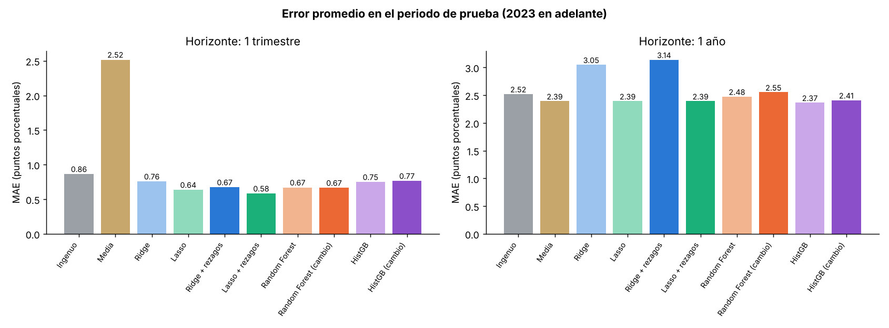
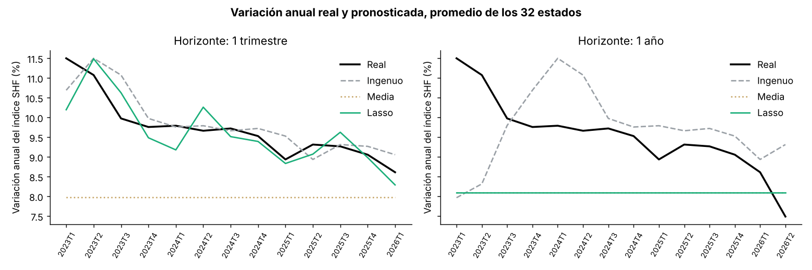
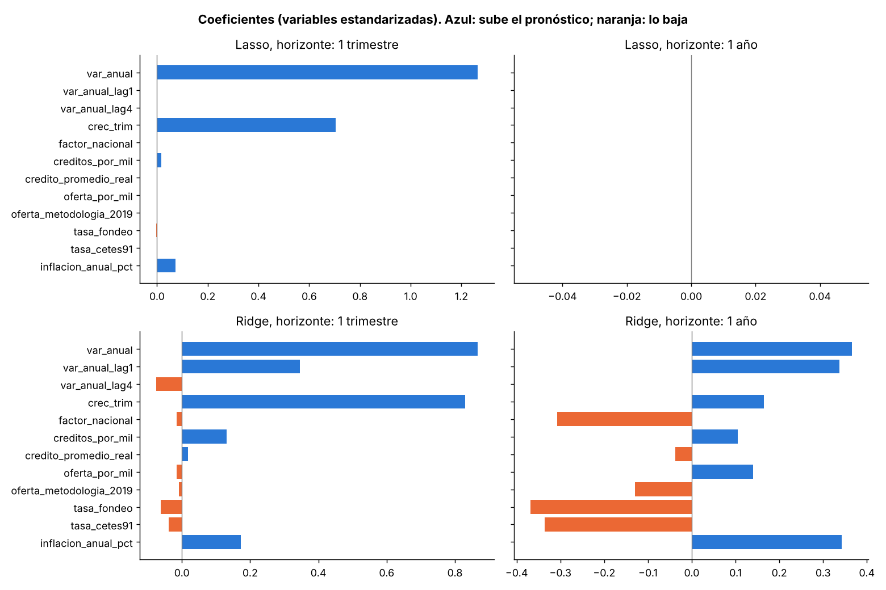
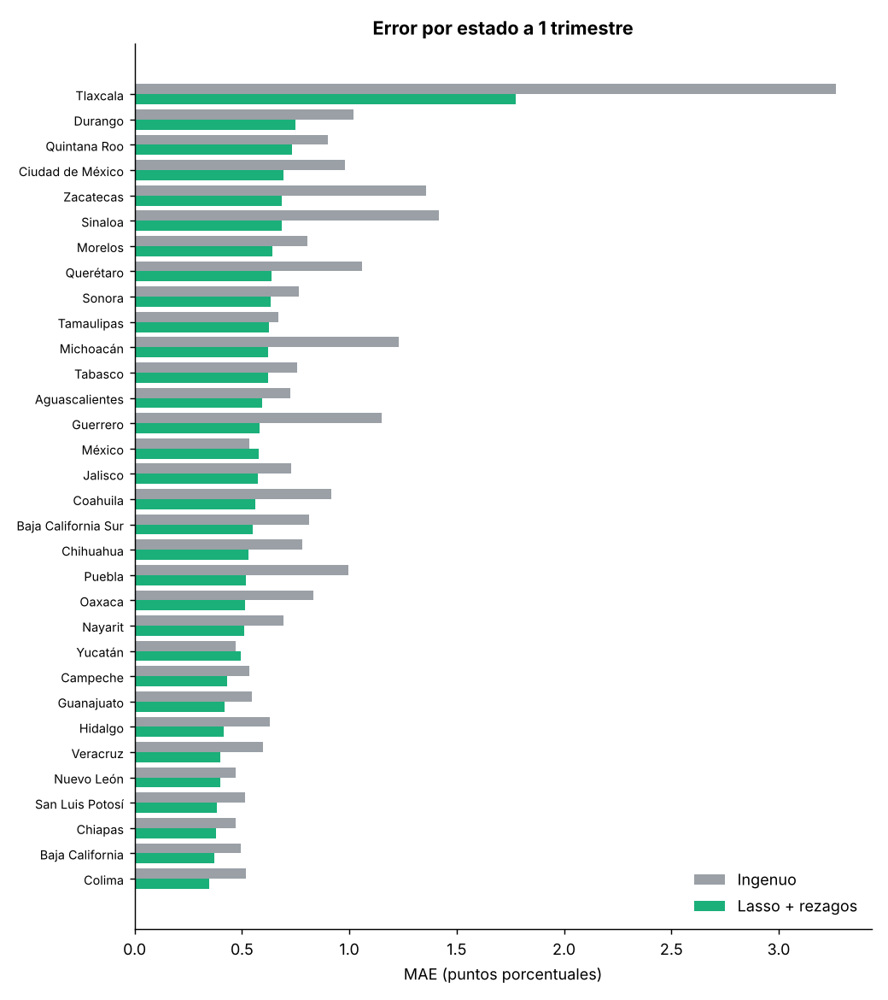

# Resultados del modelado

**El Precio del Ladrillo** · Primera entrega de modelos

---

## En resumen

- **A un trimestre, el modelo sí funciona.** Lasso le gana al pronóstico ingenuo: baja el error de 0.86 a 0.64 puntos, un 26% menos, y es mejor en 30 de los 32 estados.
- **Casi todo lo que sabe el modelo viene del propio precio.** La variación de hoy y el crecimiento del último trimestre son las variables que más pesan. El crédito, la oferta y las tasas aportan muy poco.
- **A un año, ningún modelo le gana a la media.** Lasso termina pronosticando exactamente la media, y Ridge y el ingenuo quedan peor. Con estos datos no hay información suficiente para anticipar el precio un año antes.

---

## Qué se predice

La **variación anual del índice SHF** (`var_anual_shf_pct`) de cada estado, en dos horizontes:

- **1 trimestre:** la variación del siguiente trimestre.
- **1 año:** la variación del mismo trimestre del año siguiente.

En los dos casos el modelo solo usa información que ya se conocía en el trimestre actual. No se predice el nivel del índice, porque el índice siempre sube y cualquier modelo lo "adivina" solo con la tendencia.

---

## Variables de entrada

Todas son del trimestre actual:

- **Del precio:**
  - variación anual de hoy (`var_anual`)
  - variación de un trimestre antes y de un año antes (`var_anual_lag1`, `var_anual_lag4`)
  - crecimiento del último trimestre (`crec_trim`)
  - **factor nacional:** el promedio de la variación de los otros 31 estados, como en Mattera y Franses (2025)
- **Crédito:** créditos por cada mil habitantes y crédito promedio en pesos de 2024.
- **Oferta:** viviendas en oferta por cada mil habitantes y el indicador del cambio de medición de 2019.
- **Tasas e inflación:** tasa de fondeo, tasa de CETES a 91 días e inflación anual.

---

## Modelos

1. **Ingenuo:** la variación del siguiente periodo es igual a la de hoy.
2. **Media:** el promedio de la variación en el periodo de entrenamiento.
3. **Ridge:** regresión lineal con penalización, que reduce el peso de las variables menos útiles.
4. **Lasso:** como Ridge, pero puede dejar en cero las variables que no aportan, así que también sirve para ver cuáles importan.

Los dos primeros son la referencia: un modelo solo vale si le gana al ingenuo.

---

## Validación

- **Entrenamiento:** objetivos de 2017 a 2022.
- **Prueba:** objetivos de 2023 en adelante (hasta 2026T1 a un trimestre y hasta 2026T2 a un año).
- **Por tiempo, nunca aleatoria.** Dos trimestres seguidos de un mismo estado son casi la misma fila, así que mezclarlos haría que el modelo pareciera mejor de lo que es.
- **Elección de la penalización (alpha) de Ridge y Lasso:** también por tiempo y solo dentro del entrenamiento. Se entrena con los años anteriores y se valida con 2020, 2021 y 2022.

- **Tamaño:**
  - **1 trimestre:** 736 filas de entrenamiento y 416 de prueba.
  - **1 año:** 640 filas de entrenamiento y 448 de prueba.

---

## Resultados en el periodo de prueba

**MAE y RMSE** están en puntos porcentuales: entre más bajos, mejor. **R2** mide qué tanto del movimiento real explica el modelo; 1 es perfecto y un valor negativo significa que es peor que usar el promedio.

### Horizonte: 1 trimestre

| Modelo | MAE | RMSE | R2 |
|---|---|---|---|
| Ingenuo | 0.864 | 1.180 | 0.794 |
| Media | 2.516 | 3.124 | -0.442 |
| Ridge | 0.757 | 1.038 | 0.841 |
| **Lasso** | **0.636** | **0.886** | **0.884** |

### Horizonte: 1 año

| Modelo | MAE | RMSE | R2 |
|---|---|---|---|
| Ingenuo | 2.522 | 3.286 | -0.574 |
| **Media** | **2.394** | **2.998** | **-0.310** |
| Ridge | 3.050 | 3.667 | -0.960 |
| Lasso | 2.394 | 2.998 | -0.310 |



---

## Qué significa

### A un trimestre: el precio es persistente y el modelo lo aprovecha

El ingenuo ya es difícil de superar: si hoy el precio sube 9% al año, el próximo trimestre casi seguro seguirá cerca de 9%. Lasso mejora porque además usa el **crecimiento del último trimestre**, que avisa si la variación va acelerando o frenando.

Lasso dejó en cero casi todas las demás variables. Solo conservó, con peso muy pequeño, la inflación y los créditos por cada mil habitantes. Ridge reparte el peso entre más variables, pero queda peor que Lasso.



### A un año: no alcanza la información

Lasso eligió dejar **todas** las variables en cero, así que su pronóstico es exactamente la media; en la gráfica su línea queda encima de la de la media. Ridge, que sí usa las variables, queda peor que la media.

Esto es un resultado válido, no un fracaso. Con solo nueve años de datos (de 2017 a 2025, y apenas seis para entrenar) y dos choques fuertes en medio (la pandemia de 2020 y la inflación de 2022), no hay suficientes casos para que el modelo aprenda cómo el crédito, la oferta o las tasas de hoy se reflejan en el precio de dentro de un año.

### Qué variables pesan



Los coeficientes están calculados con las variables estandarizadas, así que se pueden comparar entre sí. Las barras azules suben el pronóstico y las naranjas lo bajan.

### Dónde falla



- **Tlaxcala** es el estado con más error por mucho (MAE de 2.03 con Lasso y 3.27 con el ingenuo), porque su índice tiene movimientos más bruscos que los demás.
- Lasso solo pierde contra el ingenuo en **el Estado de México y Yucatán**.
- **Tamaulipas:** MAE de 0.65 con Lasso y 0.67 con el ingenuo.

---

## Archivos

Todo se genera desde la raíz del repo con:

```
python Proyecto/Modelado/modelado.py
```

- `modelado.py`: el script.
- `resultados_modelos.csv`: MAE, RMSE y R2 por modelo y horizonte.
- `mae_por_estado.csv`: MAE de cada estado, por modelo y horizonte.
- `coeficientes.csv`: peso de cada variable en Ridge y Lasso.
- `predicciones_prueba.csv`: valores reales y pronosticados del periodo de prueba.
- `figuras/`: las cuatro gráficas de este documento.

---

## Lo que sigue

- **Origen móvil:** repetir la prueba con varios cortes (entrenar hasta 2020, hasta 2021 y hasta 2022) y promediar el error, para que el resultado no dependa de un solo periodo de prueba.
- **Más modelos:** Random Forest y XGBoost, y, si alcanza el tiempo, una red con rezagos.
- **Importancia de variables** por permutación o SHAP.
